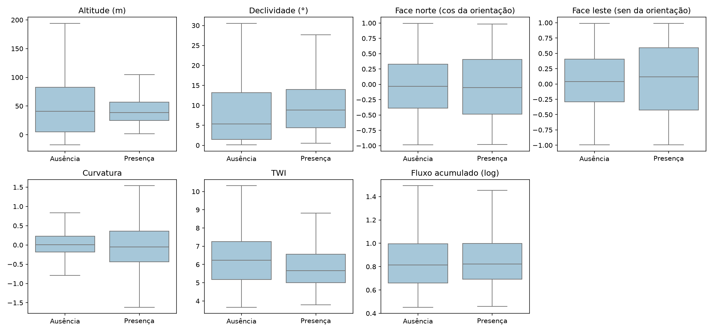
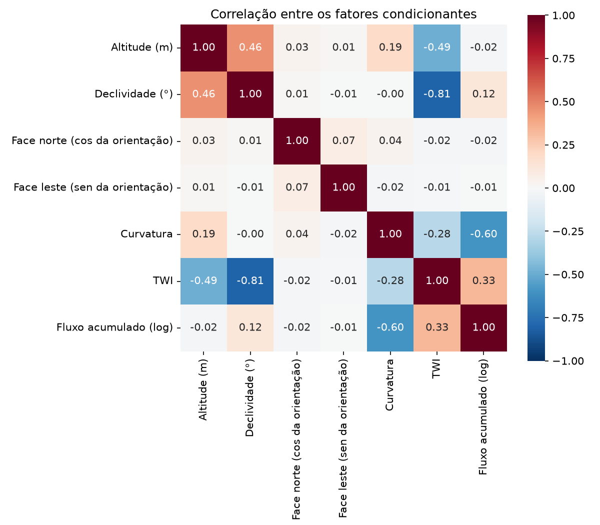
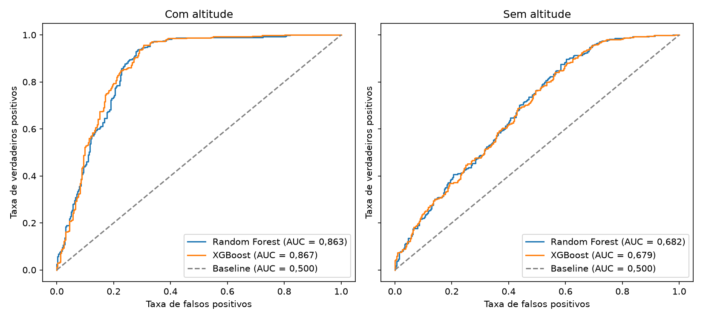
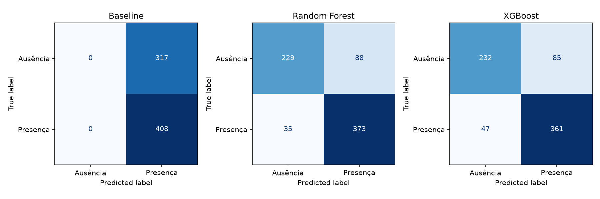
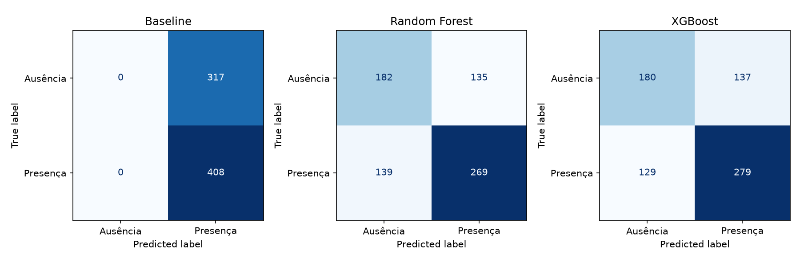
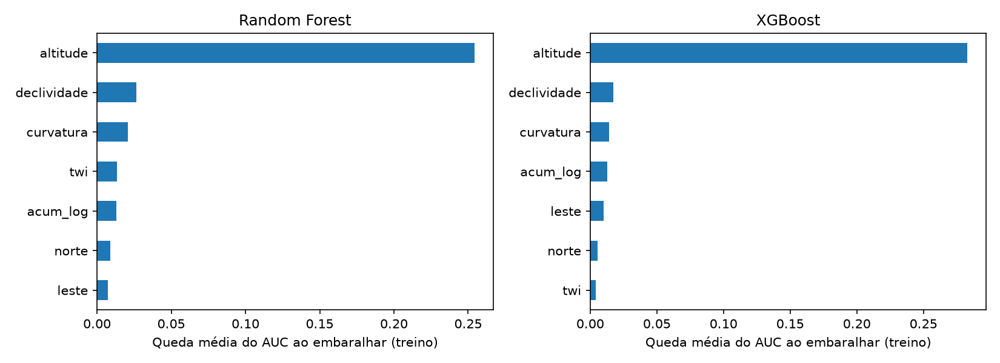
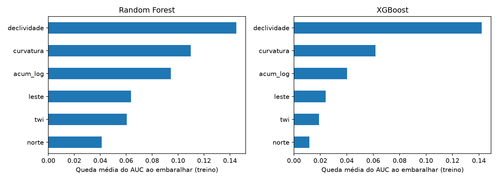
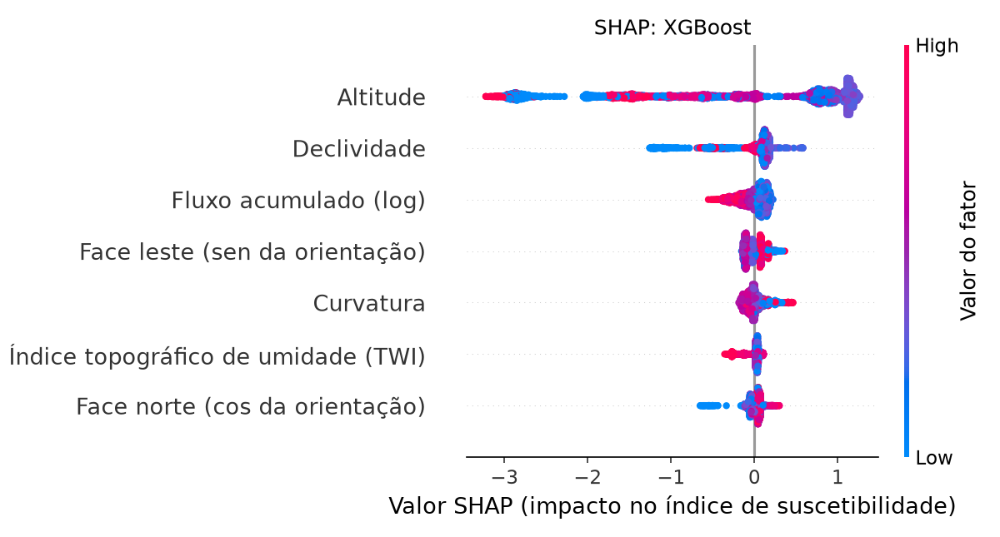
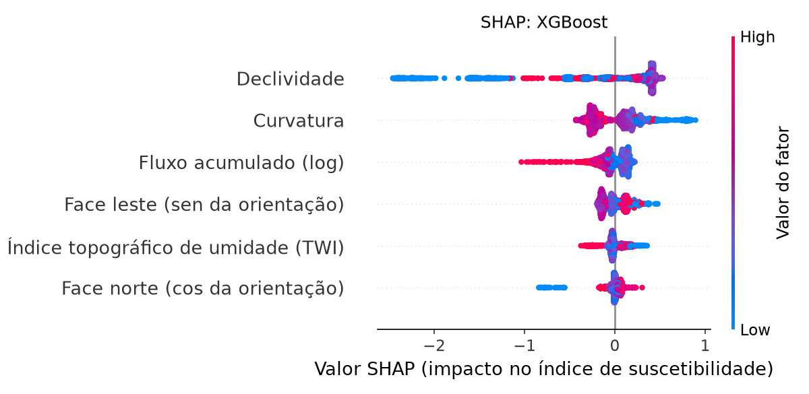

Projeto final (Capstone) do Future Tech Leaders Brasil, Space Tech Bootcamp 2026. **WebGIS:** [clar1x.github.io/suscetirmr/mapa](https://clar1x.github.io/suscetirmr/mapa/). **Código:** [github.com/clar1x/suscetirmr](https://github.com/clar1x/suscetirmr).

# Introdução e importância

A ocupação de encostas urbanas e a ocorrência de deslizamentos constituem desafios para o planejamento territorial da Região Metropolitana do Recife (RMR), onde eventos de chuvas intensas, como os de 2022, tornam a antecipação das áreas mais predispostas uma necessidade para a gestão de riscos.

**Problema.** Já existem mapas de suscetibilidade a deslizamentos para a RMR, mas faltam modelos abertos, reprodutíveis e interpretáveis, avaliados com validação espacial e capazes de mostrar quais fatores sustentam cada previsão, para Recife e Jaboatão dos Guararapes.

**Tarefa.** Classificação supervisionada binária (presença de deslizamento contra não ocorrência presumida) a partir de fatores derivados de um modelo digital de terreno.

**Objetivo específico.** Desenvolver e comparar modelos de suscetibilidade (Random Forest e XGBoost), interpretar a contribuição dos fatores com SHAP e disponibilizar os mapas em um WebGIS.

**Relevância para os ODS e para o ecossistema geoespacial.** O projeto se relaciona ao ODS 11 (Cidades e Comunidades Sustentáveis), ao apoiar o planejamento urbano, a identificação de áreas prioritárias para ações preventivas e a atuação da Defesa Civil, e ao ODS 13 (Ação Contra a Mudança Global do Clima), ao oferecer subsídios para a preparação das cidades diante de chuvas intensas. No ecossistema geoespacial, combina dados abertos (MDT PE3D e limites do IBGE), aprendizado de máquina interpretável e um WebGIS estático e de código aberto. Os mapas representam **suscetibilidade**, e não substituem análises de risco, que consideram exposição e vulnerabilidade.

# Revisão da literatura

Reichenbach et al. (2018) revisam os modelos estatísticos de suscetibilidade a deslizamentos e organizam as decisões que moldam o resultado: o inventário, as unidades de mapeamento, os fatores condicionantes, o método e a validação. Para este projeto, o trabalho serve de roteiro metodológico e reforça que a qualidade do inventário e a forma de avaliar o modelo pesam tanto quanto o algoritmo escolhido.

Merghadi et al. (2020) comparam algoritmos de aprendizado de máquina para o mesmo problema e discutem seu desempenho, com resultados competitivos para métodos baseados em árvores. Isso fundamenta a escolha do Random Forest e do XGBoost, e a lição de comparar os algoritmos sob um mesmo protocolo de avaliação foi adotada aqui.

Zhang et al. (2023) combinam XGBoost e SHAP para interpretar a suscetibilidade e examinar como a contribuição dos fatores varia no espaço (heterogeneidade geoespacial). O projeto adota a mesma dupla de técnicas e compara a estrutura de contribuições entre Recife e Jaboatão.

Na RMR, o mapa de suscetibilidade a deslizamentos de Pfaltzgraff (2007) é a referência regional, e um trabalho de 2024 propôs um mapa para a região com dados de acesso livre, validado com setores de risco e com o mapa atualizado dos deslizamentos ocorridos. Esses mapas servem de ponto de comparação; este projeto se diferencia por usar aprendizado de máquina com validação espacial, interpretação por SHAP e uma entrega aberta e reprodutível.

Dois trabalhos complementam a base metodológica: Roberts et al. (2017), que mostram por que dados com dependência espacial exigem validação cruzada em blocos, e Lundberg e Lee (2017), que propõem o SHAP. As lacunas que o projeto aborda são a avaliação com validação espacial em registros heterogêneos, a comparação entre municípios vizinhos e a entrega dos resultados em um formato aberto e interativo.

# Metodologia

## Descrição dos dados

| Dado | Formato | Conteúdo | Finalidade | Acesso |
|---|---|---|---|---|
| Registros históricos de deslizamentos | Pontos (shapefile) | Ocorrências de vários períodos | Presenças para o treinamento | **Restrito** |
| MDT PE3D/APAC (1 m, 2014 a 2016) | Raster GeoTIFF, 98 folhas | Altitude | Fatores de terreno | Público (APAC / Governo de Pernambuco) |
| Limites municipais, IBGE (malha 2024) | Shapefile | Polígonos municipais | Recorte e ausências | Público |

 Os registros de deslizamentos têm acesso restrito: foram usados apenas para treinar e avaliar os modelos e não são exibidos nem disponibilizados em nenhuma forma. Estão disponíveis publicamente o código, os modelos treinados, os mapas, os gráficos SHAP, as métricas e a distribuição percentual dos registros por classe (sem expor os pontos). O repositório está no GitHub; os modelos estão na pasta `modelos/`. A política completa está em `docs/politica_dados.md`.

**Onde encontrar os dados públicos.** O PE3D (Pernambuco Tridimensional) é um programa do Governo de Pernambuco que gerou dados espaciais de alta definição de todo o estado por varredura a laser; os produtos são consultados e baixados pelo serviço estadual [Consultar Pernambuco Tridimensional - PE3D](https://pe3d.pe.gov.br/). As malhas municipais do IBGE, agrupadas por estado, estão em [Malhas Territoriais](https://ibge.gov.br/geociencias/organizacao-do-territorio/estrutura-territorial/15774-malhas.html). Os dados de entrada restritos não são publicados, e o repositório disponibiliza os modelos e os mapas derivados (Hugging Face ou Zenodo não foram usados).

## Descrição da metodologia

**Coleta e organização.** As 98 folhas do MDT (48 de Recife e 50 de Jaboatão), todas em EPSG:31985 e `float32`, têm pixels com resolução ligeiramente diferente de 1 m (0,9997 a 1,0 m), o que gera emendas em mosaicos convencionais. Elas foram reunidas e reamostradas para uma única grade de 5 m com o GDAL (`scripts/mosaico_mdt.sh`).

**Amostragem das presenças.** Foram usados registros de 2010 a 2025 em Recife e Jaboatão, com remoção de duplicatas (10 m), no máximo 5 pontos por célula de 250 m e distância mínima de 25 m, o que resultou em 1.500 presenças com boa distribuição espacial.

**Fatores condicionantes.** Declividade e orientação (decompostas em componentes norte e leste) com `xarray-spatial`; fluxo acumulado com `pysheds` (preenchimento de depressões, direção D8 e acumulação), apresentado em escala logarítmica; curvatura e índice topográfico de umidade (TWI, calculado a partir do fluxo acumulado e da declividade); e a altitude. Cada fator foi extraído nos pontos como **média numa janela de 45 m (9 × 9 pixels)**, para atenuar a imprecisão posicional dos registros.

**Ausências.** 1.500 pontos sorteados por município, na mesma quantidade das presenças de cada um, em pixels com MDT válido e a pelo menos 100 m de qualquer presença. A base tem, portanto, classes equilibradas (1:1) por construção.

**Limpeza e estrutura dos dados.** Foram descartados os registros sem geometria válida, fora do período ou fora dos dois municípios, as duplicatas e os pontos muito próximos entre si. A tabela de modelagem tem uma linha por ponto (presença ou ausência) e a estrutura abaixo; ela contém as posições dos registros e, por isso, não é publicada.

| Campo | Descrição |
|---|---|
| `classe` | 1 = presença de deslizamento; 0 = ausência presumida |
| `municipio` | Recife ou Jaboatão dos Guararapes |
| `ano` | Ano do registro (apenas nas presenças) |
| `x`, `y` | Coordenadas em UTM 25S (EPSG:31985), restritas |
| `altitude`, `declividade`, `norte`, `leste`, `curvatura`, `twi`, `acum_log` | Fatores condicionantes (média numa janela de 45 m) |

**Análise exploratória.** A declividade no pixel dos registros é baixa em muitos casos: apenas 57% das presenças ficam com 5° ou mais, e 73% com 3° ou mais. Isso decorre da imprecisão de posição, da suavização do MDT a 5 m e de registros localizados na base ou no topo das encostas, e motivou usar uma janela de contexto (45 m) em vez do pixel exato. Por isso também não se aplicou uma máscara de declividade no treinamento. Na exibição do mapa, o relevo plano (declividade média abaixo de 1,5°, o percentil 5 das presenças) aparece em cinza.





**Leitura da análise exploratória.** As distribuições de presenças e ausências se sobrepõem bastante em todos os fatores, o que antecipa um problema de dificuldade moderada para os fatores de terreno. As diferenças mais claras são:

- **Altitude.** As presenças se concentram numa faixa intermediária e estreita (mediana de 38,7 m, com a metade central dos pontos entre cerca de 25 e 57 m). As ausências cobrem desde a baixada, com valores próximos de zero ou ligeiramente negativos, até as maiores altitudes (mediana de 41,0 m, com a metade central entre cerca de 5 e 83 m). Isso antecipa o papel dominante da altitude nos modelos: altitudes muito baixas indicam ausência.
- **Declividade.** A mediana é maior nas presenças (8,8°) do que nas ausências (5,3°), mas as metades centrais das duas distribuições se sobrepõem em grande parte, o que é coerente com o poder discriminatório moderado do fator isolado.
- **Curvatura.** Mediana próxima de zero nas ausências (terreno mais regular) e dispersão maior nas presenças, em ambos os sinais, indicando relevo mais irregular.
- **TWI.** Menor nas presenças (mediana de 5,7, contra 6,2 nas ausências), como esperado, porque o TWI diminui com o aumento da declividade.
- **Fluxo acumulado e orientação.** Praticamente iguais nas duas classes (medianas do fluxo de 0,81 e 0,82), com pouco poder discriminatório isolado.

**Correlação entre os fatores.** A maior correlação é entre declividade e TWI (−0,81), esperada porque o TWI é calculado a partir da declividade. Seguem curvatura e fluxo acumulado (−0,60), altitude e TWI (−0,49) e altitude e declividade (0,46). As componentes da orientação não se correlacionam com os demais fatores (|r| de no máximo 0,07). Os modelos baseados em árvores toleram fatores correlacionados e, como são apenas sete fatores, nenhum foi removido (a aula de Machine Learning I reduz as variáveis quando há dezenas delas, com muita redundância). A consequência está na interpretação: a importância se divide entre fatores correlacionados, então a baixa importância do TWI no SHAP não significa que a informação hidrológica seja irrelevante.

**Preparação do modelo.** Os fatores são padronizados (`StandardScaler`) dentro de um `Pipeline`, para evitar vazamento entre treino e validação.

## Seleção e exploração do modelo

Foram escolhidos o **Random Forest** e o **XGBoost**, ambos baseados em árvores de decisão.

- **Random Forest.** Média de muitas árvores treinadas em amostras diferentes. Vantagens: robusto, pouco sensível a escala e a *outliers*, captura não linearidades e interações. Limitações: menos preciso que o *boosting* em alguns casos e mais difícil de interpretar sozinho.
- **XGBoost.** Árvores construídas em sequência, cada uma corrigindo os erros das anteriores (*gradient boosting*). Vantagens: alto desempenho em dados tabulares e boa regularização. Limitações: mais hiperparâmetros e risco de sobreajuste com poucos dados.

Ambos lidam bem com a relação não linear entre os fatores de terreno e a presença de deslizamentos e com fatores correlacionados, e têm interpretação direta pelo SHAP (`TreeExplainer`). O curso apresentou outros algoritmos (regressão logística, KNN, SVM, árvore de decisão e *gradient boosting* do scikit-learn), que não foram comparados aqui; a escolha seguiu o pré-projeto e a literatura revisada. Um baseline (`DummyClassifier`) fornece a régua mínima de desempenho.

O desempenho foi avaliado em duas versões: **com altitude** e **somente com fatores de terreno (sem altitude)**. A altitude domina o modelo e funciona em parte como proxy do contexto geomorfológico (baixada contra morros); a versão sem ela é mais direta fisicamente, porém menos acurada.

## Treinamento do modelo

Seguindo o fluxo da aula de Machine Learning I, mas com divisão espacial em vez de temporal:

- **Divisão.** Os dados foram agrupados em blocos espaciais de 2 km (142 blocos). Vinte por cento dos blocos foram reservados para o **teste** (725 pontos), reservado para a avaliação final e não usado no ajuste dos hiperparâmetros; os demais (2.275 pontos) formaram o treino e a validação.
- **Otimização.** `GridSearchCV` com a métrica **AUC-ROC**, nos dois modelos, com sementes fixas (`SEED = 42`).
- **Função de perda.** Entropia cruzada (*logloss*) no XGBoost e critério de Gini no Random Forest (padrões do scikit-learn). Épocas, tamanho de lote e taxa de aprendizagem de rede neural não se aplicam.

```python
# Divisão espacial: o teste reúne blocos inteiros, nunca vistos pelo modelo
splitter = GroupShuffleSplit(n_splits=1, test_size=0.2, random_state=SEED)
idx_train, idx_test = next(splitter.split(X, y, blocos))

pipe = Pipeline([("scaler", StandardScaler()), ("modelo", XGBClassifier(...))])
busca = GridSearchCV(pipe, grade, cv=GroupKFold(n_splits=4), scoring="roc_auc")
busca.fit(X_train, y_train, groups=g_train)
```

**Grades de busca.** Random Forest: `max_depth` em {3, 5, 10, sem limite}, `min_samples_leaf` em {1, 5, 10}, `max_features` em {raiz quadrada, 0,5}, com 300 árvores. XGBoost: `n_estimators` em {100, 300}, `learning_rate` em {0,03, 0,1}, `max_depth` em {2, 4, 6} e `subsample` em {0,8, 1,0}.

**Hiperparâmetros escolhidos, com altitude.**

| Modelo | AUC validação | Hiperparâmetros |
|:--|--:|:--|
| Random Forest | 0,798 | max_depth=5, max_features=0,5, min_samples_leaf=5 |
| XGBoost | 0,800 | learning_rate=0,03, max_depth=2, n_estimators=300, subsample=0,8 |

**Hiperparâmetros escolhidos, sem altitude.**

| Modelo | AUC validação | Hiperparâmetros |
|:--|--:|:--|
| Random Forest | 0,663 | max_depth=10, max_features=sqrt, min_samples_leaf=10 |
| XGBoost | 0,663 | learning_rate=0,03, max_depth=2, n_estimators=300, subsample=0,8 |

## Validação cruzada

A validação cruzada espacial usa `GroupKFold` com 4 folds, em que cada fold deixa blocos de 2 km inteiros de fora do treino. Ela faz o papel do `TimeSeriesSplit` da aula: evitar que o modelo veja, no treino, vizinhos do que será validado, o que superestimaria o desempenho (Roberts et al., 2017).  O AUC médio de validação é de 0,80 com altitude e 0,66 sem altitude (tabelas acima). Sem altitude, o teste (0,68) coincide com a validação; com altitude, o teste (0,86) ficou acima da validação, o que pode refletir os blocos que caíram no teste.

## Avaliação do modelo

Métricas no teste (blocos espaciais nunca vistos no treino). O baseline (classe constante) tem AUC de 0,500.

| Modelo | Versão | AUC-ROC | Precisão (macro) | Recall (macro) | F1 (macro) | Acurácia |
|:--|:--|--:|--:|--:|--:|--:|
| Random Forest | Com altitude | 0,863 | 0,838 | 0,818 | 0,823 | 0,830 |
| XGBoost | Com altitude | 0,867 | 0,820 | 0,808 | 0,812 | 0,818 |
| Random Forest | Sem altitude | 0,682 | 0,616 | 0,617 | 0,617 | 0,622 |
| XGBoost | Sem altitude | 0,679 | 0,627 | 0,626 | 0,626 | 0,633 |



AUC no teste por município (XGBoost): com altitude, Jaboatão 0,881 e Recife 0,824; sem altitude, Jaboatão 0,656 e Recife 0,761 (Random Forest: com altitude, 0,875 e 0,831; sem altitude, 0,662 e 0,754).





**Leitura dos resultados.**

- Os dois modelos superam o baseline. Random Forest e XGBoost ficam empatados: a diferença de AUC é de até 0,004, dentro do ruído de um teste com 725 pontos, e não é possível afirmar que um seja melhor.
- A altitude responde pela maior parte do desempenho: sem ela, o AUC cai de cerca de 0,86 para 0,68. Os fatores de terreno sozinhos têm, portanto, poder discriminatório moderado, e o resultado é mais forte em Recife do que em Jaboatão.
- A janela de extração importa: ao passar de 15 m para 45 m, o AUC sem altitude subiu de 0,656 para cerca de 0,68, e a janela maior foi adotada. A diferença é pequena e consistente em todas as comparações, sem pretensão de significância estatística.
- A janela de extração e a comparação com e sem altitude foram decididas olhando também o desempenho no teste; a validação cruzada apontou a mesma direção apenas na versão sem altitude (de 0,650 para 0,663).





**Interpretação com SHAP.** Na versão com altitude, ela domina com folga, com efeito não monotônico: altitudes muito baixas (a baixada) puxam fortemente para "ausência" e as faixas intermediárias puxam para "presença". Na versão sem altitude, a **declividade** é o fator mais importante (SHAP médio absoluto de 0,52 em Jaboatão e 0,56 em Recife, no XGBoost), seguida da **curvatura** (0,23 e 0,24); fluxo acumulado, orientação e TWI contribuem menos (entre 0,04 e 0,12). A estrutura de contribuições é quase idêntica nos dois municípios, o que sustenta a comparação entre eles. O SHAP e a importância por permutação descrevem o que o modelo usa, não a causa dos deslizamentos. Como a declividade e o TWI são fortemente correlacionados (−0,81), a contribuição de ambos se divide entre eles; a baixa importância do TWI não deve ser lida como irrelevância do fator hidrológico.





**Distribuição dos registros por classe de suscetibilidade.** As tabelas comparam o percentual da área mapeada com o percentual dos registros em cada classe. Os registros de teste não foram usados no treino; a coluna "todos" os inclui e tende a ser mais otimista. As tabelas não expõem contagens nem posições.

**Modelo completo (com altitude)**

| Classe | Área (%) | Registros, teste (%) | Registros, todos (%) |
|:--|--:|--:|--:|
| Muito baixa | 14,6 | 0,0 | 0,2 |
| Baixa | 14,6 | 0,7 | 3,8 |
| Média | 14,6 | 15,0 | 14,4 |
| Alta | 14,6 | 33,1 | 28,9 |
| Muito alta | 14,6 | 47,1 | 47,5 |
| Relevo plano (cinza) | 26,9 | 4,2 | 5,2 |

**Somente fatores de terreno (sem altitude)**

| Classe | Área (%) | Registros, teste (%) | Registros, todos (%) |
|:--|--:|--:|--:|
| Muito baixa | 14,6 | 10,5 | 7,6 |
| Baixa | 14,6 | 13,5 | 12,2 |
| Média | 14,6 | 21,6 | 18,9 |
| Alta | 14,6 | 23,3 | 23,0 |
| Muito alta | 14,6 | 27,0 | 33,1 |
| Relevo plano (cinza) | 26,9 | 4,2 | 5,2 |

Com altitude, as duas classes mais altas (29,2% da área) concentram 80,2% dos registros de teste, e a classe "muito alta" sozinha tem cerca de 3,2 vezes a sua fatia da área; as duas classes mais baixas somam apenas 0,7%. Sem altitude, a ordem das classes se mantém (o percentual de registros cresce de 10,5% a 27,0% da classe muito baixa à muito alta, no teste), mas a separação é mais fraca: as duas classes mais altas concentram 50,3% dos registros de teste, cerca de 1,7 vez a sua fatia da área, e as duas mais baixas ainda retêm 24,0%. Isso é coerente com o AUC (cerca de 0,86 contra 0,68). Os registros no relevo plano (cinza) são 4,2% no teste e 5,2% no total, próximos dos 5% usados para definir o limiar; a pequena diferença vem de a classificação ser feita na grade de 20 m.

**Mapa.** O índice é a saída do modelo (0 a 1), em cinco classes por quintis calculados na área de relevo não plano, com o relevo plano em cinza. É um índice relativo, não uma probabilidade, e as classes são posições relativas, não níveis absolutos de perigo.

# Deployment e produto final

O produto final é um **WebGIS estático** (MapLibre GL JS), publicado no GitHub Pages ([clar1x.github.io/suscetirmr/mapa](https://clar1x.github.io/suscetirmr/mapa/)), com duas camadas alternáveis (com e sem altitude), dois mapas base (ruas e relevo), controle de opacidade, legenda, desempenho do modelo, tabela de percentuais por classe, gráfico SHAP e uma metodologia resumida. Este relatório é publicado na mesma página do projeto. Os modelos treinados estão em `modelos/`, com exemplo de uso.

# Implementação do código

Todo o código está no GitHub, com README que descreve o objetivo, a estrutura, a instalação (`uv sync`), a execução e a reprodução. O pipeline completo exige os registros restritos; quem não o tem consegue regenerar os fatores e o índice de suscetibilidade a partir do MDT público e dos modelos publicados.

| Etapa | Script |
|---|---|
| Mosaico do MDT | `scripts/mosaico_mdt.sh` |
| Amostragem | `src/amostragem.py` |
| Fatores condicionantes | `src/derivar_fatores.py` |
| Base de modelagem e EDA | `src/montar_base.py`, `src/eda_base.py` |
| Treino e avaliação | `src/treinar.py` |
| SHAP | `src/shap_analise.py` |
| Mapas e WebGIS | `src/mapa_suscetibilidade.py`, `src/exportar_webgis.py` |
| EDA e curva ROC | `src/eda_figuras.py`, `src/curva_roc.py`

# Limitações e trabalhos futuros

- **Fatores.** Os modelos usam apenas fatores derivados do MDT. Geologia e uso e cobertura da terra não foram incorporados por não estarem em escala compatível com a do MDT; a importância da altitude pode refletir, em parte, essa ausência. A incorporação dessas camadas em escala adequada é o principal trabalho futuro.
- **Registros e ausências.** Os registros se concentram onde há ocupação e atendimento a ocorrências. As ausências são presumidas (sorteadas em locais sem registro) e podem incluir deslizamentos não registrados, o que adiciona ruído aos rótulos. Áreas sem registros, como a zona rural, não foram validadas, e o índice ali reflete apenas o terreno.
- **Heterogeneidade e posição.** Os registros vêm de períodos e levantamentos distintos e têm incerteza de posição; a janela de 45 m atenua esse efeito, mas não o elimina, e suaviza feições locais como cortes e taludes.
- **Escala e idade do terreno.** O MDT de 1 m foi reamostrado para 5 m e os fatores foram extraídos em janela de 45 m. O PE3D é de 2014 a 2016, e mudanças posteriores no terreno não estão representadas.
- **Avaliação.** O teste usa um único conjunto de 725 pontos, sem intervalos de confiança, e diferenças de 0,01 a 0,02 no AUC não são interpretáveis. A janela de extração e a comparação com e sem altitude foram decididas olhando também o teste. O SHAP foi calculado em todos os pontos (treino e teste). Não houve validação externa, por exemplo usando um evento de 2022 como teste temporal.
- **Índice.** A saída não é uma probabilidade calibrada, e as classes são quintis, ou seja, posições relativas. O limiar do relevo plano foi definido a partir das presenças.
- **Fatores estáticos.** Não há chuva, cobertura vegetal nem uso do solo, que condicionam o gatilho e a estabilidade das encostas.
- **Produto.** O WebGIS exibe uma camada raster a 20 m, sem consulta por pixel nem download dos valores.
- **Perspectivas.** Transferência espacial entre os municípios, expansão para outros municípios da RMR e validação com setores de risco oficiais.

# Referências

- Pfaltzgraff, P. A. dos S. (2007). *Mapa de suscetibilidade a deslizamentos na região metropolitana do Recife*. Tese (Doutorado em Geociências), Universidade Federal de Pernambuco, Recife.
- Torres, F. S. de M.; Pfaltzgraff, P. A. dos S. (2024). Construção de mapas de suscetibilidade a deslizamentos com uso de dados de acesso livre: Região Metropolitana do Recife (PE). *Geotecnia*, 160, 25-36. doi:10.14195/2184-8394_160_2
- Reichenbach, P. et al. (2018). A review of statistically-based landslide susceptibility models. *Earth-Science Reviews*, 180, 60-91. doi:10.1016/j.earscirev.2018.03.001
- Merghadi, A. et al. (2020). Machine learning methods for landslide susceptibility studies: a comparative overview of algorithm performance. *Earth-Science Reviews*, 207, 103225. doi:10.1016/j.earscirev.2020.103225
- Zhang, J. et al. (2023). Insights into geospatial heterogeneity of landslide susceptibility based on the SHAP-XGBoost model. *Journal of Environmental Management*, 332, 117357. doi:10.1016/j.jenvman.2023.117357
- Roberts, D. R. et al. (2017). Cross-validation strategies for data with temporal, spatial, hierarchical, or phylogenetic structure. *Ecography*, 40, 913-929.
- Lundberg, S. M.; Lee, S.-I. (2017). A unified approach to interpreting model predictions. *Advances in Neural Information Processing Systems*, 30.
- Material do curso: ebook do Future Tech Leaders Brasil (<https://ftl-brazil-2026.github.io/ebook/>).